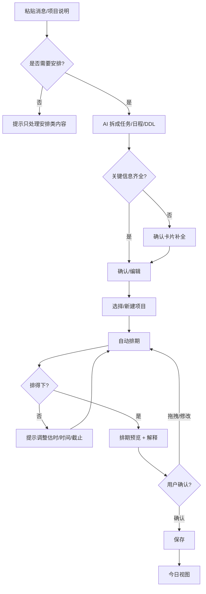

# 小排 PRD v0.1

> **把项目、群消息丢进来，小排帮你排好。**
>
> 产品名：小排（XiaoPai）  
> 版本：v0.1  
> 日期：2026-10-18  
> 状态：草案，待用户确认  
> 平台：微信小程序（MVP）  
> 前身：课旁（课表 + 通知），2026-10-18 转型

---

## 0. 变更记录

| 日期 | 版本 | 变更 |
|---|---|---|
| 2026-10-18 | v0.1 | 产品从「课表 + 群通知识别」转为「AI 排期助手」；核心竞争力改为自动排期；目标用户扩大到事务多的学生和上班族；课表导入降为次要能力；MVP 不做每日提醒；产品名定为「小排」 |
| 2026-10-19 | v0.1（修订） | 修正 AI 抽取评测口径：真实评测集为 7 条，不是计划的 30 条；7 条只作方向性信号和错误模式分析，不用于估计总体准确率 |

---

## 1. 产品定位

### 1.1 一句话

**小排是一个微信小程序：把微信/QQ 群消息、项目说明或一段待办粘贴进来，它自动拆成任务、日程和 DDL，按截止时间、优先级和空闲时间排进日历；你确认或拖拽后保存，打开小程序就知道今天做什么。**

### 1.2 30 秒介绍

大学生和年轻上班族每天都在接收大量碎片信息：群通知、项目要求、作业截止、活动安排。现在的工具要么只记待办，要么只给日历，中间的「拆解、估时、排期」仍然靠人。

小排把这段工作接过来：用户复制一段杂乱文字，小排识别出任务、日程和 DDL，追问缺失信息，自动排进日历，并解释为什么这么排。用户确认或拖拽后，得到一份可执行的计划。

课表导入是次要能力：它只是日历里的一类固定事件，不是产品的核心。

### 1.3 它是什么 / 不是什么

| 是 | 不是 |
|---|---|
| 从中文消息/项目说明到可执行排期的 AI 助手 | 又一个手动待办清单 |
| 自动拆任务、估时、排期、标 DDL | 团队项目管理 / 甘特图 / 资源排班 |
| 用户确认、可拖拽、可解释的排期 | 黑箱自动写入、不可修改的日程 |
| 微信小程序内粘贴消息/项目 | 把长按转发给微信客服作为 MVP 核心入口 |
| 微信内闭环，复制粘贴即可 | 自动读取微信/QQ 聊天记录 |
| 先服务事务多的学生 | 一开始就做全行业、全平台 |

---

## 2. 背景与问题

### 2.1 个人起点

我长期在微信群、QQ 群里接收通知和项目要求，也在用课表、备忘录和日历。反复出现的麻烦是：

1. 一段消息里混着活动、时间、地点、截止日期，要手动拆出来；
2. 知道 DDL，但不知道应该从哪天开始做；
3. 日程、任务、DDL 分散在不同工具里，优先级看不清；
4. 每天早上要重新想一遍「今天到底做什么」。

原来的「课旁」解决的是第 1 步：把群通知识别成日程/DDL，再和课表放在一起。但真正让我焦虑的不是「记不下来」，而是「记下来之后没有计划」。所以这次转型把核心从「识别」移到「排期」。

### 2.2 现有替代方案

| 方案 | 用户怎么用 | 主要问题 |
|---|---|---|
| 备忘录 / 纸笔 | 收到消息后手动抄 | 不提醒、不排期、容易漏 |
| 滴答清单 / TickTick | 手动建任务、设提醒 | 输入成本高；不会自动拆消息；排期仍靠人 |
| 飞书日历 / 任务 | 手动建日程和任务 | 偏团队协作；中文消息不能直接变成计划 |
| Notion / Notion Calendar | 自己搭系统 | 重、需要维护；不自动排期 |
| Motion / Reclaim / Clockwise | AI 自动排期 | 主要面向英文/海外工作流；不接微信/QQ 消息；价格高 |
| 微信里的提醒机器人 | 发消息、设提醒 | 只提醒，不拆任务、不排期 |
| 脑子记 | 靠记忆 | 高焦虑、易漏 |

### 2.3 为什么现在

- 大模型对中文通知、项目说明的抽取能力已经可用，能把「下周三前交报告」拆成任务和截止时间；
- 自动排期可以先从规则做起，不需要复杂的运筹优化；
- 微信小程序是学生最顺的入口，复制/粘贴的成本远低于手动建任务；
- 现有访谈和竞品研究可以复用，但**必须重新验证「自动排期」这个新核心**。

### 2.4 关键洞察：事实与假设

| # | 洞察 | 现状 | 验证方式 |
|---|---|---|---|
| I1 | 用户常在微信/QQ 收到需要记录的通知和项目要求 | 个人经验 + 1 份访谈，样本不足 | 访谈 8–12 人；问卷 |
| I2 | 手动拆解时间、地点、截止日期是负担 | 假设 | 访谈中让对方复现最近一次操作 |
| I3 | 用户真正缺的是「什么时候做」，不是「记在哪」 | 本次转型的核心假设 | 概念测试 + 原型测试 |
| I4 | 用户愿意粘贴一段文字换取一份排期 | 假设，最大风险之一 | 2–3 人 pilot；观察是否真的粘贴 |
| I5 | 用户接受 AI 排期，但要求可确认、可拖拽、可解释 | 假设 | 原型测试；记录接受/拖拽率 |
| I6 | 课表不是核心，只是日历中的固定事件 | 本次产品决策 | 不作为 MVP 验收项 |
| I7 | 每日提醒很重要，但微信推送受限，MVP 先不做 | 本次产品决策 | V1 单独验证渠道 |
| I8 | 上班族是后续扩展用户，不是 MVP 首批 | 本次产品决策 | 学生验证后再做飞书/企微/Outlook |

> 结论：这份 PRD 里的用户规模、频率、意愿，凡是没有标注来源的，都按「待验证假设」处理，不能写成研究结论。

---

## 3. 目标用户

### 3.1 主要用户（MVP）

**事务密度高的大学生**，典型特征：

- 学生干部、班长/团支书、社团负责人；
- 参加竞赛、科研、实习，多个项目并行；
- 课程多，群通知多，DDL 和活动混在一起；
- 主要用手机和微信/QQ，不愿意手动录入；
- 愿意为了「少动脑」付出一次确认。

**Persona A：社团负责人小林**

- 大二，社团每周活动 + 课程作业 + 比赛报名；
- 群里每天十几条通知，靠备忘录和脑子记；
- 经常在 DDL 前一天才开始；
- 想要：把消息丢进去，直接知道这周哪天做什么。

**Persona B：竞赛/实习学生小周**

- 大三，竞赛项目 + 实习 + 课程报告并行；
- 项目说明很长，任务之间有先后关系；
- 用飞书/Notion 记录，但排期还是靠手；
- 想要：把项目说明变成排期，DDL 前留出时间。

### 3.2 次要用户（后续）

- 初入职场、项目执行型岗位：运营、市场、行政、初级产品/研发；
- 使用飞书/企微/钉钉/Outlook 日历；
- 需要把工作项目说明变成排期，但涉及公司数据，隐私要求更高；
- 进入时机：学生 MVP 验证通过后，再评估是否做企业IM/日历集成。

### 3.3 非目标用户

- 需要团队协作、任务分派、甘特图、资源排班的团队；
- 已经有一套重度日历/项目管理体系、且不想改变的人；
- 只需要「到点提醒」、不需要排期的人；
- 不愿意粘贴/输入任何内容的人；
- 需要自动读取聊天记录、自动替用户发消息的人。

### 3.4 为什么先做学生

1. 现有访谈、问卷、竞品研究都在学生场景，复用成本低；
2. 微信/QQ 是主入口，复制粘贴路径短；
3. 学生干部/社团/竞赛群体事务密度高，痛点明显；
4. 更容易找到 2–3 个 pilot 用户；
5. 上班族的日历/IM 生态更复杂，放到验证之后。

### 3.5 用户特征

- 手机为主，习惯微信内操作；
- 对「多一步跳转」敏感，但对「一次确认」有耐心；
- 对隐私敏感：不希望产品读取聊天记录；
- 对 AI 错误敏感：宁可多确认，也不要写错；
- 愿意为「省脑子」付费的意愿未知，MVP 不验证付费。

---

## 4. 用户问题与 JTBD

### 4.1 四个核心问题

1. **拆解成本高**：一段消息/项目说明里混着多个事项，要手动拆成任务、时间、地点、DDL。
2. **有 DDL，没有计划**：知道什么时候截止，但不知道从哪天开始、每次做多久。
3. **优先级不清**：日程、任务、DDL 混在一起，不知道先做哪个。
4. **每天重新想**：早上打开工具，看到的是一堆事项，不是「今天做什么」。

### 4.2 Jobs to be Done

> 当我收到一段杂乱的项目说明或群消息时，我想把它直接丢进去，立刻得到一份能执行的排期，这样我不用手动整理，也不会漏 DDL。

> 当我早上开始一天时，我想看到今天该做什么、先做哪个，这样我不用重新规划。

### 4.3 典型场景

**场景 1：周一早上，三条群通知 + 一个课程报告**

- 输入：社团活动通知、比赛报名截止、课程报告要求；
- 小排拆成：2 个日程、2 个 DDL、1 个任务；
- 追问：报告预计多久？比赛报名是否需要材料？
- 排期：报告拆成 3 个时间块，放在周三/周四晚上；活动固定在周四 19:00；报名截止前一天提醒（V1）；
- 用户确认/拖拽后保存。

**场景 2：社团活动筹备**

- 输入：「下周五办活动，需要借教室、做海报、拉赞助、发通知」；
- 小排拆成任务，识别依赖：先借教室，再发通知；海报在活动前 3 天完成；
- 自动排进空闲时间；排不下的任务提示用户调整。

**场景 3：临时插入**

- 用户粘贴一条新通知；
- 小排识别冲突：与已有安排冲突；
- 给出「替换 / 顺延 / 放弃」选项；
- 用户确认后只重排未锁定的任务。

**场景 4：早上打开**

- MVP：打开小程序，看到「今日」视图；
- V1：早上收到微信提醒，点开就是今日安排。

### 4.4 现在 vs 小排

| 步骤 | 现在 | 小排 |
|---|---|---|
| 收到消息 | 看一眼，靠脑子记 | 复制粘贴 |
| 拆事项 | 手动 | AI 拆成任务/日程/DDL |
| 估时 | 凭感觉 | AI 建议，用户可改 |
| 排期 | 手动放进日历 | 自动排进空闲时间，可拖拽 |
| 看今天 | 重新翻列表 | 今日视图 |
| 提醒 | 零散闹钟/备忘录 | V1 按任务节奏提醒 |

---

## 5. 竞品与替代方案

### 5.1 竞品对比

| 产品 | 输入 | 自动拆解 | 自动排期 | DDL | 提醒 | 中文消息 | 主要不足 |
|---|---|---|---|---|---|---|---|
| 滴答清单 / TickTick | 手动 | 否 | 否 | 有 | 强 | 支持 | 输入成本高，排期靠人 |
| 飞书日历 / 任务 | 手动/IM | 部分 | 否 | 有 | 强 | 支持 | 偏团队协作，不自动排期 |
| Notion Calendar | 手动 | 否 | 否 | 有 | 中 | 支持 | 重，需自己搭系统 |
| Motion | 项目/任务 | 部分 | 强 | 有 | 强 | 弱 | 海外工作流，不接微信/QQ，价格高 |
| Reclaim / Clockwise | 日历 | 否 | 强 | 部分 | 强 | 弱 | 偏会议/工作日历，不处理中文通知 |
| 微信提醒机器人 | 消息 | 部分 | 否 | 部分 | 中 | 强 | 只提醒，不排期 |
| 备忘录/纸笔 | 手动 | 否 | 否 | 否 | 弱 | — | 无提醒、无排期 |

### 5.2 竞品结论

- 海外已有 AI 自动排期产品，但没有一个把「中文微信/QQ 消息 → 任务/DDL → 自动排期」串起来；
- 国内清单/日历产品强在记录和提醒，弱在「替用户做计划」；
- 团队协作、复杂项目管理不是小排的战场；
- 小排的机会是：**中文消息输入 + 学生场景 + 自动排期 + 微信内闭环**。

### 5.3 USP（独特价值）

1. **从中文消息/项目说明直接生成排期**，不是让用户先建任务；
2. **自动拆解 + 估时 + 排进空闲时间 + 标 DDL**；
3. **排期可解释、可确认、可拖拽**，不是黑箱；
4. **微信内复制粘贴即可**，不读取聊天记录，不要求授权通讯录；
5. **先服务事务多的学生**，不做泛化的团队工具。

### 5.4 值得借鉴

- 滴答清单：任务/优先级/提醒的清晰结构；
- 飞书日历：日/周视图和任务详情；
- Motion：自动排期的解释和「为什么放这里」；
- Notion：极简输入，先让用户把内容丢进来。

### 5.5 壁垒

早期没有技术壁垒。可能的壁垒是：

- 中文消息/项目说明的抽取规则和失败样本库；
- 个人排期偏好数据（工作时间、估时习惯、拖拽行为）；
- 用户信任：排期准、可修改、不丢数据；
- 微信内的低门槛入口和反馈闭环。

这些都需要真实用户使用才能积累，不能靠 PRD 写出来。

---

## 6. 产品目标与指标

### 6.1 北极星指标

**每周被用户确认并执行的排期任务数。**

理由：它同时反映「排期有没有用」和「用户有没有真的照做」，比 DAU、创建任务数更接近价值。

### 6.2 MVP 目标（2–3 周 pilot）

- 招募 10–20 名事务多的学生；
- 完成首次「粘贴 → 确认 → 排期」转化；
- 观察第 2 周是否还回来；
- 收集排期接受/拖拽/放弃的原因；
- 不追求付费、不追求大规模增长。

### 6.3 指标表

| 阶段 | 指标 | 定义 | MVP 目标 |
|---|---|---|---|
| 激活 | 首次排期完成率 | 粘贴后 10 分钟内确认至少 1 个排期块 | ≥ 60% |
| 激活 | 首次排期时长 | 从粘贴到保存 | 中位数 ≤ 5 分钟 |
| 质量 | 事件级抽取准确率 | 正确识别的事项 / 标注事项 | ≥ 80% |
| 质量 | 时间准确率 | 时间字段正确 | ≥ 80% |
| 质量 | 地点准确率 | 地点字段正确 | ≥ 80% |
| 质量 | 类型准确率 | 日程/DDL/任务分类正确 | ≥ 80% |
| 质量 | 幻觉率 | 原文没有、模型编出的时间/地点/事项 | < 5% |
| 质量 | 排期接受率 | 未拖拽直接确认的排期块 / 全部排期块 | ≥ 50% |
| 质量 | 排期拖拽率 | 被拖拽的排期块 / 全部排期块 | 记录，不设硬目标 |
| 留存 | 第 2 周回访率 | 第 2 周仍打开并产生排期 | ≥ 40%（小样本，仅参考） |
| 价值 | DDL 错过率 | 用户标记错过 / 全部 DDL | 记录，目标低于基线 |
| 价值 | 今日视图打开率 | 打开今日视图 / 活跃用户 | 记录 |
| 护栏 | 排期错误投诉 | 用户反馈「排得不对」 | 记录并逐条分析 |
| 护栏 | 隐私投诉/删除请求 | 用户要求删除数据 | 0 起为佳 |
| 护栏 | 用户焦虑反馈 | 「看到这么多任务更焦虑」 | 记录 |

> 小样本只做定性信号，不写成「X% 用户愿意用」的统计结论。抽取质量指标当前基于 7 条真实输入，按「通过条数 / 7」记录，不用于估计总体准确率；80% / 5% 需扩样后才具备统计意义。

### 6.4 不追求的指标

- DAU/MAU 的绝对值；
- 功能数量；
- 任务创建数（可以刷，但不代表执行）；
- 付费转化（MVP 不验证）。

---

## 7. 核心概念与数据模型

### 7.1 概念定义

| 概念 | 定义 | 例子 |
|---|---|---|
| 收件箱 Inbox | 用户粘贴的原始输入 | 一段群通知 |
| 项目 Project | 一组相关事项 | 「社团迎新活动」 |
| 任务 Task | 需要投入时间完成的事，可被排期 | 「写课程报告初稿」 |
| 日程 Event | 固定时间要参加的事，不参与自动排期 | 「周四 19:00 社团开会」 |
| DDL / Deadline | 硬截止时间，是排期约束 | 「周五 23:59 前提交报名表」 |
| 排期块 ScheduleBlock | 任务被安排到的一个时间段 | 「周三 19:00–20:30 写报告」 |
| 提醒规则 ReminderRule | 某个事项的提醒节奏（V1） | 「每天 08:00」「DDL 前 3 天」 |
| 偏好 Preference | 用户的工作时间、缓冲、默认估时 | 「工作日 19:00–22:30」 |

### 7.2 数据模型

```text
User
- id, wechat_openid, timezone
- workday_start, workday_end, weekend_start, weekend_end
- buffer_min, default_estimate_min
- morning_brief_time (V1), created_at

Project
- id, user_id, name, color, status, created_at

Item
- id, project_id, user_id
- type: task | event | deadline
- title, description
- start_at, end_at          # event 的固定时间
- deadline_at               # task/deadline 的截止时间
- location
- priority: P0 | P1 | P2 | P3
- estimate_min              # task 预计时长
- status: inbox | parsed | needs_confirmation | scheduled | in_progress | done | missed | canceled
- confidence, source_text
- created_at, updated_at

Dependency
- item_id, depends_on_item_id

ScheduleBlock
- id, item_id, start_at, end_at
- locked (用户拖拽/锁定后不再自动移动)
- reason (排期解释)
- created_at, updated_at

ReminderRule (V1)
- id, item_id, type: daily | interval | before_deadline | custom
- time_of_day, interval_days, days_before
- channel: in_app | wechat_service | wechat_subscribe | email
- enabled, last_sent_at

Feedback
- id, user_id, item_id, type: wrong_time | wrong_location | wrong_type | wrong_schedule | other
- raw_text, note, created_at
```

### 7.3 状态机

```text
inbox
  → parsed
  → needs_confirmation
  → scheduled
  → in_progress
  → done
  ↘ missed
  ↘ canceled
  ↺ rescheduled
```

规则：

- `event` 不需要排期，直接进入 `scheduled`；
- 低置信度或缺失关键字段 → `needs_confirmation`；
- 排期失败 → 仍为 `needs_confirmation`，提示用户调整；
- 用户拖拽 → 更新 `ScheduleBlock`，标记 `locked`；
- 完成后释放未使用的排期块。

### 7.4 优先级

| 优先级 | 定义 | 排期倾向 |
|---|---|---|
| P0 | 24 小时内截止，或不可延期 | 最先排，允许挤占 P2/P3 |
| P1 | 7 天内截止，或重要项目 | 优先排，留缓冲 |
| P2 | 普通任务 | 按截止时间排 |
| P3 | 有空再做 | 最后排；排不下时提示放弃/延后 |

AI 给建议优先级，用户可修改；修改后重排。

### 7.5 时间类型

- **固定日程 Event**：有明确开始/结束，锁定，不自动移动；
- **弹性任务 Task**：有截止时间/预计时长，可被排进空闲时间；
- **DDL**：硬约束，可以独立存在，也可以挂在任务上；
- **依赖 Dependency**：B 必须在 A 之后，排期时先排 A。

---

## 8. 核心用户流程

### 8.1 首次使用

1. 微信授权登录；
2. 隐私告知 + 同意（明确：只处理用户主动粘贴的内容，不读取聊天记录）；
3. 设置可支配时间（默认：工作日 19:00–22:30，周末 09:00–22:00）；
4. 粘贴第一条消息/项目说明；
5. 进入主流程。

### 8.2 主流程：粘贴 → 排期

```text
粘贴文本/项目说明
→ 意图判断（是不是需要记录/安排的内容）
→ AI 拆成多个事项（任务 / 日程 / DDL）
→ 确认卡片（可编辑，补缺失信息）
→ 选择/新建项目
→ 自动排期
→ 排期预览（日历 + 列表 + 解释）
→ 用户确认 / 拖拽 / 锁定
→ 保存
→ 今日视图
```

### 8.3 日常使用

1. 打开小程序，默认进入「今日」；
2. 看到今天排期块、临近 DDL、逾期项；
3. 操作：开始、完成、顺延、拆分、放弃、重排；
4. 有新消息时，回到粘贴入口继续加。

### 8.4 新输入与变更

- 新输入可以并入已有项目；
- 重复事项提示合并，不自动覆盖；
- 新日程与已有排期冲突时，提示「替换 / 顺延 / 放弃」；
- 用户拖拽/锁定的块不自动移动，除非发生硬冲突；
- 截止时间变化 → 重排未锁定块；
- 任务完成 → 释放后续排期块，可提前下一项。

### 8.5 失败与异常

| 情况 | 处理 |
|---|---|
| 完全无法解析 | 保留原文，提示手动创建；不强行生成 |
| 缺少时间/截止 | 标为「待补充」，不排期；提示用户 |
| 缺少地点 | 允许保存，地点为空；日程可提示 |
| 低置信度 | 确认卡片高亮字段，要求用户确认 |
| 没有空闲时间 | 标记「排不下」，给出：延长可支配时间 / 减少估时 / 拆分 / 延后 / 放弃 |
| 截止时间已过 | 提示「已逾期」，询问补做/取消 |
| 重复输入 | 提示可能重复，让用户选择合并/新建 |
| 任务太多 | 每天排期上限（默认 4 小时），超出部分提示顺延；不把一天塞满 |

### 8.6 课表（次要能力）

- MVP 不把课表导入作为验收项；
- 课表只是一个固定日程来源：后续支持手动添加/文件导入；
- 不把「课表同屏」作为核心卖点；
- 先验证「消息 → 排期」，再考虑课表。

### 8.7 提醒（MVP 不做）

- MVP：只有打开小程序时的「今日」视图，没有推送；
- V1：每日早报 + 按任务节奏提醒（每天 / 隔几天 / DDL 前 N 天）；
- 渠道限制见 9.7，不在 MVP 承诺。

### 8.8 主流程图



---

## 9. 功能需求

### 9.1 MVP 范围

| 编号 | 功能 | 优先级 | 验收标准 |
|---|---|---|---|
| F1 | 微信小程序 + 粘贴输入 | P0 | 用户可粘贴多行文本；可从剪贴板读取（需用户点击触发）；保留来源标记 |
| F2 | 意图判断 + 多事项抽取 | P0 | 能区分安排类/闲聊；一条输入拆出多个事项；输出标题、类型、时间、截止、地点、优先级、估时、缺失字段、置信度 |
| F3 | 确认卡片 | P0 | 字段可编辑、可增删事项；低置信度高亮；重复提示；可归入项目 |
| F4 | 自动排期 | P0 | 按截止/优先级/空闲时间排入；避让固定日程；给出解释；支持拖拽/锁定/重排 |
| F5 | 今日 + 日历视图 | P0 | 今日排期、临近 DDL、逾期；日/周视图；项目视图 |
| F6 | 任务状态 | P0 | 开始、完成、顺延、拆分、放弃、重排；完成后释放时间 |
| F7 | 手动创建/编辑 | P0 | AI 失败时可手动建任务/日程/DDL |
| F8 | 今日视图（无推送） | P0 | 打开小程序默认进入今日；不承诺推送 |
| F9 | 隐私与数据 | P0 | 同意、删除、导出、留存说明；不读取聊天记录 |
| F10 | 反馈/纠错 | P1 | 可标记错误类型；反馈进入后台 |
| F11 | 埋点 | P1 | 关键事件可追踪；见 9.11 |
| F12 | 课表导入 | P2 | 不作为 MVP 验收项；后续支持 |

### 9.2 功能细节

#### F1 输入

- 主入口：小程序首页「粘贴一条消息/项目」；
- 支持：手动粘贴、点击「读取剪贴板」（用户主动触发，不后台监听）；
- 多行文本；保留原文；
- 来源标记：微信/QQ/其他（用户选择或默认）；
- 不做：自动读取聊天记录、后台监听剪贴板、读取通讯录。

#### F2 抽取

必须输出：

- 事项列表（1–N 个）；
- 每个事项：标题、类型（task/event/deadline/unknown）、时间、截止时间、地点、优先级、预计时长、依赖、缺失字段、置信度、原文证据；
- 无法判断时用 `unknown`，不硬猜；
- 相对时间按当前日期解析；无法解析保留原文并标缺失；
- 原文没有的时间/地点一律为空，禁止编造；
- 多事项按语义拆分，不把一段话硬塞成一个任务。

#### F3 确认卡片

- 每个事项一张卡片，可展开编辑；
- 必填：标题、类型；任务需截止或「未定」；日程需时间；
- 低置信度/缺失字段高亮；
- 支持批量确认、删除、合并；
- 重复检测：标题+时间+地点相似 → 提示；
- 可归入已有项目或新建项目；
- 不自动保存到日历，必须用户确认。

#### F4 自动排期

输入：

- 弹性任务：截止时间、优先级、预计时长、依赖；
- 固定日程：开始/结束；
- 用户偏好：可支配时间、缓冲、每日上限；
- 已有排期块（locked/unlocked）。

输出：

- 每个任务的排期块（可多个）；
- 排期解释；
- 排不下的任务及原因；
- 可选调整建议。

规则：

1. 固定日程先锁定；
2. 任务按「最早截止 → 优先级 → 依赖顺序」排序；
3. 在截止前的可支配时间里找空档；
4. 单个块默认 25–90 分钟；超过 90 分钟拆分；
5. 块间留 10 分钟缓冲；
6. 不跨过固定日程；
7. 每日排期不超过用户上限（默认 4 小时）；
8. 没有足够时间 → 不硬塞，标记「排不下」；
9. 用户拖拽/锁定后，重排只动未锁定块；
10. 每个排期块给一句解释。

#### F5 今日 + 日历视图

- 今日：按时间顺序展示排期块；顶部「临近 DDL」；逾期标红；
- 周视图：7 天，排期块 + 固定日程；
- 项目视图：按项目分组；
- 空状态：引导粘贴第一条；
- 加载状态：解析中、排期中；
- 错误状态：解析失败、排期失败，给下一步动作。

#### F6 任务状态

- 开始：标记进行中；
- 完成：释放未使用块，里程碑庆祝（轻量，不浮夸）；
- 顺延：选择新时间/自动找下一个空档；
- 拆分：把一个任务拆成多个子任务；
- 放弃：确认后取消，DDL 保留记录；
- 重排：只重排未锁定块。

#### F7 手动创建/编辑

- AI 失败/用户不想粘贴时的兜底；
- 字段与抽取结果一致；
- 手动创建也要能进入自动排期。

#### F8 今日视图（MVP）

- 默认首页；
- 展示今天、未来 3 天 DDL、逾期；
- 不发送任何推送；
- 文案明确「打开小程序查看」，不承诺每日提醒。

#### F9 隐私与数据

- 首次使用单独同意；
- 明确：只处理主动粘贴内容；不读取聊天记录；不后台监听剪贴板；
- 原文默认不长期保存：抽取完成后保留结构化结果；原文按用户设置 30 天删除；
- 提供删除全部数据、导出数据；
- 第三方 LLM/OCR 供应商：不训练、不留存、境内存储（或明确告知）；
- 未成年人：不主动营销；涉及付费前做年龄确认。

#### F10 反馈/纠错

- 每个事项可反馈：时间错、地点错、类型错、排期不合理、其他；
- 反馈不阻塞主流程；
- 后台按错误类型聚合，驱动 prompt/规则迭代。

#### F11 埋点

见 9.11。

#### F12 课表

- P2，不进 MVP 验收；
- 后续支持手动添加固定课程/文件导入；
- 课表只是固定日程来源，不做「课表同屏」核心卖点。

### 9.3 V1 范围

- 每日早报 + 按任务节奏提醒；
- 图片/截图输入（多模态）；
- 日历导出/订阅（.ics）；
- 外部日历导入（飞书/企微/Outlook，先评估）；
- 重复任务/习惯任务；
- 更好的排期偏好（精力曲线、固定不可用时间）；
- 课表导入；
- 分享/导出计划（图片/文本）。

### 9.4 暂不做

- 团队协作、任务分派、甘特图、资源排班；
- 微信客服/长按转发入口（后续可选，不作为 MVP 核心）；
- 自动读取微信/QQ 聊天记录；
- 自动替用户发消息；
- 社交、社区、广告；
- 复杂教务系统对接；
- 支付/订阅（MVP 不验证付费）；
- 多语言/海外；
- 全平台 App（先微信小程序）。

### 9.5 页面清单

| 页面 | 目的 | 关键元素 | 状态 |
|---|---|---|---|
| Onboarding | 授权、隐私同意、设置时间 | 微信登录、隐私说明、可支配时间 | 首次 |
| 首页/粘贴 | 输入入口 | 粘贴框、读取剪贴板、示例 | 空/有历史 |
| 解析中 | 等待 | 进度、取消 | 加载 |
| 确认卡片 | 校对抽取结果 | 事项卡片、编辑、缺失高亮、项目 | 正常/低置信度/重复 |
| 排期预览 | 确认排期 | 日历、列表、解释、拖拽、锁定 | 正常/排不下 |
| 今日 | 执行 | 今日排期、DDL、逾期、操作 | 空/正常/逾期 |
| 周视图 | 看全局 | 7 天、项目颜色、DDL | 正常 |
| 任务详情 | 编辑/反馈 | 字段、排期块、依赖、反馈 | 正常 |
| 项目 | 分组 | 项目列表、进度 | 空/正常 |
| 设置 | 偏好/隐私 | 时间、缓冲、每日上限、删除/导出 | 正常 |
| 反馈 | 纠错 | 错误类型、备注 | 正常 |

### 9.6 核心交互细节

- 粘贴后先显示「我看到了 N 个事项」，再逐张确认；
- 缺失字段不挡住全部流程：可先保存为「待补充」，但不排期；
- 排期解释用一句话，例如「放在周三 19:00，因为周五 23:59 截止，周三晚上是最近的可支配时间」；
- 拖拽后显示「已锁定，不再自动移动」；
- 排不下时给具体选项，不只说「失败」；
- 完成后释放时间，提示「下一项可以提前」。

### 9.7 提醒规则（V1，不在 MVP）

**规则类型：**

| 类型 | 例子 | 适用 |
|---|---|---|
| 每天提醒 | 每天 08:00 提醒今日任务 | 当日计划 |
| 隔 N 天提醒 | 每 3 天提醒一次项目进度 | 长期项目 |
| DDL 前 N 天 | DDL 前 3 天、1 天各提醒一次 | 截止事项 |
| 自定义 | 指定日期/时间 | 特殊事项 |
| 每日早报 | 每天 08:00 汇总今日 + 临近 DDL | 全局 |

**规则：**

- 完成后停止提醒；
- 可暂停/恢复；
- 可设置免打扰时段；
- 同一事项不重复轰炸；
- 早报包含：今日排期、未来 3 天 DDL、逾期、排不下的事项。

**渠道与限制：**

- 微信小程序订阅消息：一次性，用户每次授权才能发一条，不能可靠支撑每日提醒；
- 微信服务号模板消息：可发，但需要组织主体/认证，且有模板和频率限制；
- 邮件/日历：可作为兜底，但不是微信内闭环；
- **在渠道未验证前，产品文案不承诺「每天自动提醒」；V1 先小范围验证。**

### 9.8 AI 抽取与失败处理

**流水线：**

```text
意图判断 → 事项抽取 → 字段规范化 → 缺失追问 → 排期 → 排期解释
```

**输出 schema（与 Coze 工作流一致）：**

```json
{
  "events": [
    {
      "title": "string|null",
      "type": "task|event|deadline|unknown",
      "start_time": "YYYY-MM-DD HH:mm|null",
      "end_time": "YYYY-MM-DD HH:mm|null",
      "deadline": "YYYY-MM-DD HH:mm|null",
      "location": "string|null",
      "priority": "P0|P1|P2|P3|null",
      "estimate_min": 0,
      "dependencies": [],
      "confidence": 0.0,
      "missing_fields": [],
      "evidence": "string",
      "ambiguity": "string|null"
    }
  ],
  "needs_confirmation": true,
  "notes": "string|null"
}
```

**原则：**

- 不编造时间、地点、截止日期；
- 缺失用 null，不猜；
- 多事项拆分；
- 相对时间按当前日期解析；
- 低置信度必须确认；
- 解析失败保留原文，转手动。

**评测：**

- 真实评测集：当前 7 条（已脱敏群通知，见 `06-研究发现/coze测试数据/`），单条可多轮运行；
- 当前覆盖：7 条均为群通知类，以单事项为主；项目说明、多事项拆分、复杂模糊时间仍缺样本，扩样时优先补；
- 用途：跑通抽取流程、建立标注口径、发现错误模式；7 条不足以估计总体准确率，不写「准确率 80%」这类统计结论；
- 指标：事件级、时间、地点、类型、估时、幻觉率；结果按「通过条数 / 7」记录；
- 当前阶段门槛（方向性）：事件/时间/地点/类型 ≥ 6/7，幻觉 0/7；
- 80% / 5% 保留为扩样后的目标；未过当前门槛不进入正式开发，先改 prompt/规则；
- 扩样来源：从访谈对象和同学处继续收集真实消息，脱敏后再加入评测集；不用编造数据凑数。

### 9.9 权限与隐私

- 只处理用户主动粘贴/上传的内容；
- 不读取微信/QQ 聊天记录；
- 不后台监听剪贴板；
- 首次使用单独同意；
- 原文默认不留存；结构化结果按需保存；
- 提供删除/导出；
- 第三方 LLM：确认不训练、不留存、境内存储；
- 敏感信息提示：不要粘贴身份证号、银行卡号等；产品做基础过滤；
- 未成年人：不主动营销；付费前年龄确认；
- 小程序备案、隐私保护指引、用户协议。

### 9.10 技术方案（高层）

**MVP 技术栈（建议）：**

- 前端：微信小程序原生（或 Taro/uni-app，按团队熟悉度）；
- 后端：Spring Boot 3.x（用户已有 Java 基础）或 Node.js；
- 数据库：MySQL 8 / PostgreSQL；
- AI：国内大模型 API（通义千问/豆包/DeepSeek），结构化输出；
- 排期：后端规则引擎（非复杂优化）；
- 日历：小程序内自绘；导出 .ics（V1）；
- 登录：微信 code2session；
- 部署：国内云，HTTPS + ICP 备案；
- 埋点：自建事件表，先不做 BI。

**AI 调用：**

- 每次粘贴调用 1 次意图判断 + 1 次抽取（可合并）；
- 低置信度二次追问；
- 输出 JSON 校验；失败重试 1 次；仍失败转手动；
- prompt 版本化，记录每次变更。

**成本（粗估）：**

- LLM：按每次抽取 1–3k tokens 估算；
- 服务器/数据库：pilot 阶段最低配；
- 微信认证/备案：按实际；
- 目标：pilot 阶段每月 < 200 元（不含人力），具体以供应商报价为准。

**技术风险：**

- 中文相对时间/模糊时间解析；
- 多事项拆分；
- 排期算法在信息不足时的合理性；
- 微信审核/隐私合规；
- 订阅消息/服务号提醒限制。

### 9.11 埋点

| 事件 | 触发 | 属性 | 用途 |
|---|---|---|---|
| paste_start | 点击粘贴/读取剪贴板 | source | 输入意愿 |
| parse_success | 抽取成功 | item_count, latency | 抽取质量 |
| parse_fail | 抽取失败 | error_type | 失败分析 |
| confirm_edit | 用户修改字段 | field, item_type | 抽取准确率 |
| schedule_generated | 生成排期 | block_count | 排期能力 |
| schedule_accepted | 确认排期 | accepted_count, dragged_count | 排期接受率 |
| schedule_dragged | 拖拽 | from, to | 排期质量 |
| task_done | 完成任务 | item_type | 价值 |
| task_rescheduled | 顺延 | reason | 计划变更 |
| today_view | 打开今日 | source | 回访 |
| feedback | 反馈 | type | 错误分布 |
| delete_data | 删除数据 | — | 隐私 |

### 9.12 里程碑

| 阶段 | 时间 | 产出 | 门槛 |
|---|---|---|---|
| M0 研究 | 第 1 周 | PRD + 低保真原型 + 7 条真实输入 | 用户确认定位/MVP 范围 |
| M1 抽取 | 第 2 周 | 7 条真实输入多轮复测 + prompt 迭代 | 事件/时间/地点/类型 ≥ 6/7，幻觉 0/7（样本有限，仅作方向性门槛） |
| M2 排期原型 | 第 2–3 周 | 可点击排期原型 + 规则引擎 | 2–3 人 pilot 能完成「粘贴 → 确认 → 排期」 |
| M3 小程序 MVP | 第 3–4 周 | 粘贴、抽取、确认、排期、今日视图 | 主流程/加载/空/错误四态通过 |
| M4 pilot | 第 5 周 | 10–20 名学生使用 | 激活 ≥ 60%，第 2 周回访 ≥ 40%（小样本） |
| M5 决策 | 第 6 周 | 继续/调整/停止；V1 提醒方案 | 用户确认 |

### 9.13 风险与开放问题

| # | 风险/问题 | 影响 | 应对 |
|---|---|---|---|
| R1 | 用户不愿意粘贴长文本 | 核心输入不成立 | 先测 2–3 人；提供示例；一键读取剪贴板 |
| R2 | 用户不信任自动排期 | 核心价值不成立 | 解释 + 可拖拽 + 只建议不强制 |
| R3 | 用户不愿提供估时 | 排期不准 | 给默认估时；允许「不知道」；从历史学习 |
| R4 | 抽取准确率不够 | 确认成本高 | 7 条真实样本多轮复测；继续扩样；低置信度追问；手动兜底 |
| R5 | 排期算法不合理 | 用户放弃 | 规则简单可解释；先覆盖常见场景；pilot 迭代 |
| R6 | 微信提醒受限 | 每日提醒承诺不了 | MVP 不做；V1 验证服务号/订阅消息 |
| R7 | 隐私担忧 | 不敢粘贴 | 明确告知；不读聊天；删除/导出；本地脱敏提示 |
| R8 | 上班族扩展成本高 | 市场故事大但落地难 | 先学生；V1 再评估飞书/企微/Outlook |
| R9 | 课表分散注意力 | 范围膨胀 | 课表 P2，不进 MVP 验收 |
| R10 | 证据不足 | PRD 变成想象 | 明确标注假设；pilot 前不写「已验证」 |

**开放问题：**

1. 用户更愿意粘贴「一条消息」还是「整个项目说明」？
2. 自动排期应该默认排多满？每天 2 小时还是 4 小时？
3. 用户更在意「排得准」还是「排得快」？
4. 任务估时由 AI 给默认值，还是必须用户填写？
5. V1 每日提醒用服务号模板消息，还是先做邮件/日历？
6. 课表导入是否值得做，还是只做手动固定日程？
7. 上班族版本是否要等学生验证通过后再做？

### 9.14 面试怎么讲（3 分钟版）

1. **问题来源**：我自己长期在群里收通知、在备忘录里记 DDL，发现真正麻烦的不是「记下来」，而是「记下来之后没有计划」；
2. **转型**：原来做的是课表 + 通知识别，后来把核心改成「从消息/项目说明直接生成排期」，课表降为次要；
3. **方案**：微信小程序粘贴 → AI 拆任务/日程/DDL → 确认 → 按截止/优先级/空闲时间自动排期 → 今日视图；排期可解释、可拖拽；
4. **边界**：MVP 不做每日提醒（微信推送受限），不做团队协作，不读聊天记录；课表 P2；
5. **验证**：先用 7 条真实输入多轮复测抽取（样本有限，只作方向性信号），再用 2–3 人 pilot 测「愿不愿意粘贴、接不接受自动排期」，最后 10–20 人看第 2 周回访；
6. **差异化**：中文消息/项目说明直接变成排期，不是又一个待办清单；先服务事务多的学生。

### 9.15 附录

#### A. 名字

- **小排**：读作「小排期 / 帮你排」，像一个排期搭子；
- Slogan：**把消息丢进来，小排帮你排好。**
- 备选：时序（偏专业）、就位（偏克制）、排得开（偏口语）；
- 说明：面试项目先用工作名，正式商用前做商标/域名检索。

#### B. 事实与假设清单

| 类型 | 内容 |
|---|---|
| 事实 | 用户会在微信/QQ 收到通知和项目要求（个人经验 + 1 份访谈） |
| 事实 | 现有清单/日历工具需要手动建任务，自动排期产品主要在海外 |
| 假设 | 用户愿意粘贴文本换取排期 |
| 假设 | 用户接受 AI 排期，但要求可确认/可拖拽/可解释 |
| 假设 | 学生干部/社团/竞赛群体的事务密度足够高 |
| 假设 | 每日提醒是留存关键（尚未验证，MVP 不做） |
| 决策 | 课表降为 P2，不做 MVP 验收 |
| 决策 | MVP 先做学生，上班族后续 |
| 决策 | MVP 不做每日提醒，只做今日视图 |

#### C. 术语

- **排期**：把任务放进具体时间块；
- **可支配时间**：用户愿意用来做任务的时间段；
- **锁定**：用户拖拽/确认后，排期不再自动移动；
- **排不下**：在截止前没有足够可支配时间；
- **今日视图**：打开小程序看到的今天安排，不是推送。
